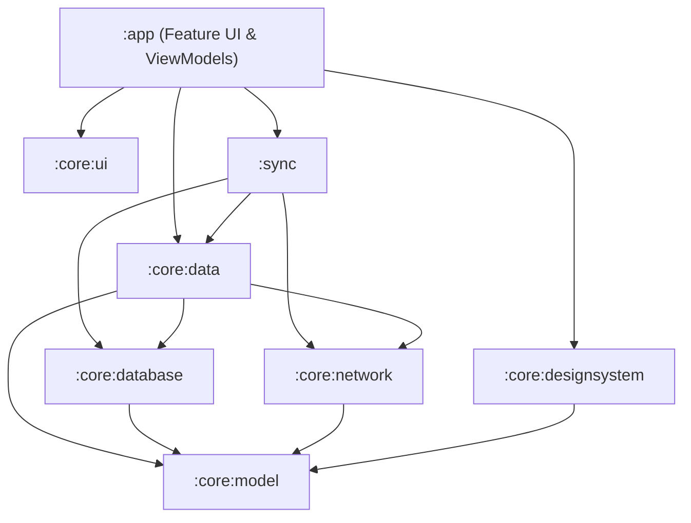

# 🌍 QuakeMind (AFET) — Disaster Decision Support & Response Platform

<p align="center">
  
  
  
  
  
  
  
</p>

---

## 📌 Genel Bakış (Overview)

**QuakeMind (AFET)**, afet anında ve sonrasında karar destek sağlayan, **çevrimdışı öncelikli (offline-first)**, Kotlin/Jetpack Compose tabanlı bir Android uygulamasıdır. Yerel ihbar kuyruğu ve WorkManager eşitlemesi bağlantı kesintilerinde tekrar denemeyi destekler; sunucu kabulü olmadan ihbar gönderildi olarak işaretlenmez.

Uygulama; sunucunun deprem kataloğu, OpenStreetMap tabanlı harita, yapay zekâ destekli hasar ve metin ön incelemesi, yaya rotası, kişisel güvende durumu ve afet çantası hazırlığı modüllerini tek bir çatı altında birleştirir.

---

## ✨ Temel Özellikler (Core Features)

```
┌─────────────────────────────────────────────────────────────────────────────┐
│                             QUAKEMIND APP                                   │
├───────────────────┬───────────────────┬───────────────────┬─────────────────┤
│ 🚨 Deprem Kataloğu │ 🗺️ Afet Haritası  │ 🛡️ Çevrimdışı     │ 🔄 Arka Plan    │
│    Kaynak & Tarih │    Yakın Yerler  │    İhbar Kuyruğu  │    Eşitleme     │
├───────────────────┼───────────────────┼───────────────────┼─────────────────┤
│ 🤖 Yapay Zeka     │ 🧭 Yaya Rotası    │ 👨‍👩‍👧 Güvende Durumu│ 🎒 Afet Çantası  │
│    Hasar & NLP    │    Rota Motoru    │    & SOS Sinyali  │    Hazırlık Seti│
└───────────────────┴───────────────────┴───────────────────┴─────────────────┘
```

- **Deprem kayıtları:** Sunucunun deprem kataloğundan alınan konum, büyüklük, tarih ve kaynak bilgileri.
- **Harita:** OpenStreetMap üzerinde deprem kayıtları, AFAD toplanma alanları ve yakındaki hizmet noktaları.
- **🛡️ Çevrimdışı İhbar ve Takip (Offline-First Incident Queue):** Ağ bağlantısı olmasa dahi tekil `idempotencyKey` ile yerel Room DB'ye kaydedilen ve takip kodu üreten güvenli ihbar sistemi.
- **🔄 Kesintiye Dayanıklı Arka Plan Eşitleme (Batch Sync):** `IncidentSyncWorker` ile 50'lik atomik transaction blokları (`claimPendingBatch`), exponential backoff ve kilit kurtarma (`resetStaleUploading`).
- **🤖 Backend AI Analizi (NLP & Damage Assessment):** Acil durum metinlerinden ihtiyaç ve aciliyet çıkarımı, fotoğrafta çatlak/bina hasarı ön incelemesi ve bölgesel risk skoru FastAPI backend üzerinden hesaplanır. Sunucu veya model erişilemezse gerçek sonuç üretilmez.
- **Yaya rotası:** Sunucu, yol ağı ve bilinen engeller üzerinden rota üretir.
- **Güvende durumu ve SOS:** Kişisel durum bildirimi, konumlu SOS çağrısı, düdük ve flaşör. Aile üyelerinin konum ve pil takibi geliştirme kapsamındadır.
- **🎒 Afet Çantası Kontrolü (Emergency Kit Checklist):** Hayati öneme göre sıralanmış, hızlı işaretlenebilir ve izole state ile çalışan kontrol listesi.

---

## 🏛️ Modüler Mimari (Architecture)

Proje, **Clean Architecture**, **Unidirectional Data Flow (UDF)** ve katı modüler ayrım prensiplerine dayanır:

```
mobile/
├── app/                                        # Application Shell, Feature Screens, Navigation & ViewModels
│   └── src/main/kotlin/com/quakemind/
│       ├── MainActivity.kt                     # Single Activity (Edge-to-edge)
│       ├── navigation/                         # Type-safe (@Serializable) Navigation Compose
│       └── feature/                            # Feature-first Scoped UI Modülleri
│           ├── home/                           # Deprem akışı & ana panel
│           ├── map/                            # Toplanma alanları & Canvas harita
│           ├── alerts/                         # Bölgesel afet bildirimleri
│           ├── report/                         # Çevrimdışı ihbar formu
│           ├── emergency/ (sos, safety)        # SOS paneli & Aile durumu
│           ├── preparedness/ (checklist, risk) # Afet çantası & risk analizi
│           ├── analysis/ (nlp, damage, routing)# Hasar tespiti & tahliye rotaları
│           └── profile/ (auth, operations)     # Kullanıcı profili & Saha koordinasyonu
│
├── core/
│   ├── model/                                  # Pure Kotlin Domain Modelleri
│   ├── database/                               # Room şeması v3, Composite Index, IncidentDao, Migrations
│   ├── network/                                # Remote API sözleşmeleri, OkHttp, NetworkMonitor
│   ├── data/                                   # Bounded Repositories & Local/Remote DataSources
│   ├── designsystem/                           # Tema ve renk belirteçleri, Tipografi, M3 Bileşenler
│   ├── ui/                                     # Generic UiState<T> ve UI uzantıları
│   └── testing/                                # Test Fixtures, Fake DAO ve Fake NetworkMonitor
│
├── sync/                                       # WorkManager Worker, Crash Recovery & Sync Scheduler
├── benchmark/                                  # AndroidX Macrobenchmark & Baseline Profile Generator
└── docs/                                       # Mimari, Performans ve Geliştirme Dokümantasyonu
```

### 🧩 Katmanlar ve Bounded Context Repositories



---

## Performans Ölçümleri

`benchmark/` modülündeki AndroidX Macrobenchmark senaryoları başlangıç ve etkileşim sürelerini ölçer.

---

## 🎨 Tasarım Sistemi (Design System)

- **Renk Paleti:** Marka ve seçim vurgusunda camgöbeği. Afet aciliyeti kırmızı, uyarılar turuncu, güvenlik durumu yeşil.
- **Tipografi:** Google Fonts modern sans-serif hiyerarşisi (Clear numeric metrics, WCAG 2.1 AA kontrast oranı).
- **Geometri ve Boşluklar:** 4 dp base grid (8, 12, 16, 24, 32), 20 dp Card radius, 12 dp Button radius, minimum 48 dp dokunma hedefi.
- **Erişilebilirlik:** Renk bağımsız ikonografi + metin etiketleri, dynamic font scaling ve tam karanlık mod desteği.

---

## 🛠️ Teknoloji Yığını (Tech Stack)

| Kategori | Teknoloji / Kütüphane | Versiyon / Not |
|---|---|---|
| **Dil & Derleyici** | Kotlin / KSP | `2.3.21` / KSP 2.3 |
| **UI Framework** | Jetpack Compose BOM | `2026.06.00` (Material 3) |
| **Mimari & Asenkron** | MVVM / MVI + Kotlin Coroutines & Flow | Scoped StateFlow, UDF |
| **Dependency Injection** | Dagger Hilt | `2.59.2` |
| **Veritabanı (Local)** | Room v2 with SQLite B-Tree Index | `2.8.4` (Composite Index) |
| **Arka Plan İşleri** | AndroidX WorkManager | `2.10.1` (Chunked Batch Sync) |
| **Navigasyon** | Navigation Compose | Type-safe `@Serializable` |
| **Görsel & Medya** | Coil 3 | Asenkron görsel işleme |
| **Performans & Test** | Macrobenchmark, Baseline Profile, JUnit4, MockK | AndroidX Benchmark `1.4.1` |

---

## 🚀 Başlangıç ve Derleme (Getting Started)

### Gereksinimler
- **Android Studio:** Android Studio Meerkat / Ladybug (AGP 9.3+ uyumlu)
- **JDK:** Java 17 veya üzeri
- **Android SDK:** Compile SDK 37, Min SDK 26

### Derleme Komutları (Gradle)

```powershell
# 1. Projeyi derleyin (Debug APK)
.\gradlew.bat :app:assembleDebug

# 2. Tüm birim testleri çalıştırın
.\gradlew.bat test

# 3. Lint ve statik kod analizini çalıştırın
.\gradlew.bat :app:lintDebug

# 4. Release APK üretin (R8 minified)
.\gradlew.bat :app:assembleRelease
```

### Test ve Doğrulama

```powershell
# Cihaz/Emülatör üzerinde UI Regresyon testleri:
.\gradlew.bat :app:connectedDebugAndroidTest

# Macrobenchmark & Startup Performans ölçümü:
.\gradlew.bat :benchmark:connectedBenchmarkAndroidTest
```

Backend URL, misafir/giriş oturumu, gerçek API sözleşmeleri, çevrimdışı ihbar tekilleştirmesi ve mevcut sunucu kısıtları için [Backend Entegrasyonu](docs/BACKEND_INTEGRATION.md) belgesine bakın.

---

## 📚 Dokümantasyon Dizini (Documentation)

Proje hakkında detaylı teknik dokümanlara `docs/` dizininden ulaşabilirsiniz:

- 📐 [**Mimari ve Veri Akışı Dokümanı (ARCHITECTURE.md)**](docs/ARCHITECTURE.md) — Katman yapısı, repository/datasource sınırları ve sequence diyagramları.
- ⚡ [**Final Performans ve Optimizasyon Raporu (PERFORMANCE.md)**](docs/PERFORMANCE.md) — 4 fazlık optimizasyon detayları, Room composite index ve batching analizleri.
- 📊 [**Performans Baseline Raporu (PERFORMANCE_BASELINE.md)**](docs/PERFORMANCE_BASELINE.md) — Faz 0 başlangıç ölçümleri, hotspotlar ve mimari riskler.
- 📜 [**Geliştirme Kuralları (DEVELOPMENT_RULES.md)**](docs/DEVELOPMENT_RULES.md) — State yönetimi, DB güvenliği ve performans regresyonunu önleme rehberi.
- 🔌 [**Backend API Gereksinimleri (API_REQUIREMENTS.md)**](docs/API_REQUIREMENTS.md) — OpenAPI ve uç nokta entegrasyon kontratları.
- 📱 [**Ürün ve Arayüz Tasarımı (PRODUCT_DESIGN.md)**](docs/PRODUCT_DESIGN.md) — Bilgi mimarisi, wireframe'ler ve tasarım sistemi.

---

<p align="center">
  <sub>Geliştirildi: <strong>QuakeMind Core Engineering Team</strong> · Afet Koşullarında Dayanıklı Yazılım Mimarisi</sub>
</p>
