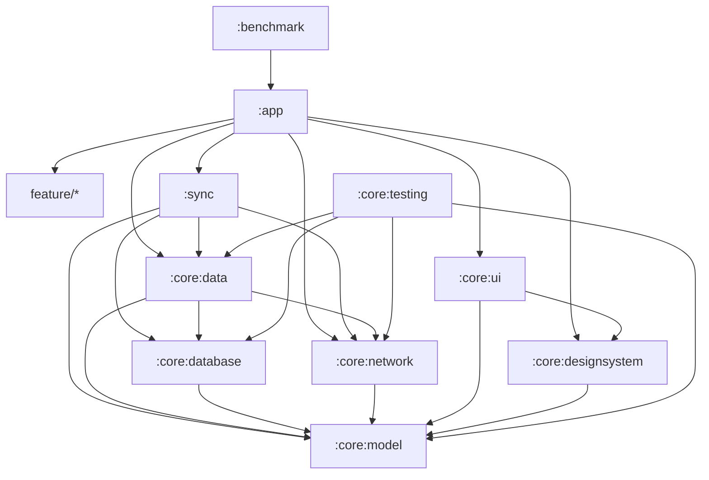
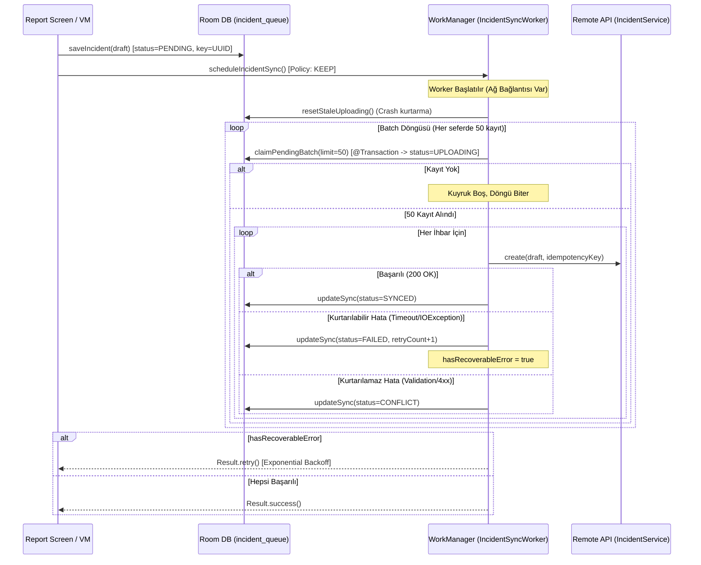

# QuakeMind (AFET) Mimari ve Veri Akışı Dokümantasyonu (ARCHITECTURE.md)

**Tarih:** 15 Ağustos 2026\
**Faz:** Faz 4 — Data/Sync Optimizasyonu, Katmanlı Mimari ve Final Performans Kapanışı\
**Proje:** QuakeMind (AFET) Android Uygulaması\

---

## 1. Genel Mimari Prensipleri

QuakeMind mimarisi, gerçek afet koşullarında yüksek veri hacmi, düşük/kesintili ağ bağlantısı, minimum bellek ayak izi ve sıfır veri kaybı prensipleri üzerine inşa edilmiştir:

1. **Unidirectional Data Flow (UDF) & Feature-Scoped State:** State her zaman yukarıdan aşağıya (StateFlow) akar, kullanıcı etkileşimleri yukarıya lambdalar ile iletilir. Root seviyede monolitik state toplanmaz.
2. **Offline-First & Idempotent Sync:** Kullanıcı tarafından oluşturulan tüm ihbarlar anında yerel Room veritabanına (`incident_queue`) `PENDING` durumu ve benzersiz `idempotencyKey` ile yazılır. Ağ bağlantısı geldiğinde `IncidentSyncWorker` arka planda güvenli şekilde kuyruğu senkronize eder.
3. **Layered Data Sources & Bounded Repositories:** Monolitik tek repository yerine ayrık domain repository sözleşmeleri (`IncidentRepository`, `EarthquakeRepository`, `AlertRepository`, vb.) kullanılır. Her repository, `LocalDataSource` (Room DB/In-memory cache) ve `RemoteDataSource` (API servisleri) sınırlarıyla net olarak ayrılmıştır.
4. **Crash-Resilient Atomic Batching:** Sync kuyruğu RAM'e tek seferde yüklenmez; 50'lik kontrollü batch'ler halinde `@Transaction` sınırında atomik olarak `UPLOADING` durumuna claim edilir. Uygulama çökmesi/kapatılması durumunda `resetStaleUploading()` kilitli kalan kayıtları otomatik kurtarır.
5. **Ayrık Ağ ve Kuyruk Durumu:** Ağ bağlantısı (`NetworkMonitor`) ve yerel ihbar kuyruğu (`pendingCount`) birbirinden bağımsız olarak modellenir.

---

## 2. Final Modül Ağacı ve Görev Dağılımı

```
QuakeApp/
├── app/                                        # Application shell, DI root, Activity, Navigation orkestrasyonu
│   └── src/main/kotlin/com/mobile/
│       ├── MainActivity.kt                     # Single Activity, edge-to-edge
│       ├── QuakeMindApplication.kt             # Hilt Application, WorkManager konfigürasyonu
│       ├── App.kt                              # Stateless root shell (AppNavHost + BottomNav)
│       ├── navigation/                         # Type-safe (@Serializable) rota tanımları ve NavHost
│       └── feature/                            # Feature paketleri (Route, Screen, ViewModel, UiState)
│           ├── home/                           # Ana sayfa, deprem akışı, acil durum özeti
│           ├── map/                            # Vektörel harita, toplanma alanları ve sahra hastaneleri
│           ├── alerts/                         # Bölgesel afet uyarıları ve detayları
│           ├── report/                         # Çevrimdışı ihbar oluşturma ve takip
│           ├── emergency/ (sos, safety)        # SOS acil çağrı ve aile güvendeyim durumu
│           ├── preparedness/ (checklist, risk) # Afet çantası ve risk analizi
│           ├── analysis/ (nlp, damage, routing)# Yapay zeka metin/hasar analizi ve güvenli tahliye rotaları
│           ├── profile/                        # Kullanıcı profili, kan grubu, gönüllülük
│           ├── operations/                     # Saha koordinasyonu ve operasyon masası
│           └── auth/ (splash, onboarding, login)
│
├── core/
│   ├── model/                                  # Pure Kotlin domain modelleri (MediaUploadDraft, AiInferenceEngine dahil)
│   ├── database/                               # Room DB v2, IncidentDao (batch/claim/reset), MIGRATION_1_2
│   ├── network/                                # Remote servis kontratları, OkHttpClient, NetworkMonitor, Dispatchers
│   ├── data/                                   # Katmanlı Local/Remote DataSources ve Bounded Repositories
│   ├── designsystem/                           # AfetCrimson teması, tipografi, tokenlar, ortak componentler
│   ├── ui/                                     # Generic UiState<T>, AppUiState, UI extensionları
│   └── testing/                                # Test Fixtures, FakeIncidentDao, FakeNetworkMonitor
│
├── sync/                                       # WorkManager worker ve offline senkronizasyon scheduler'ı
│   ├── worker/ (IncidentSyncWorker.kt)         # Chunked batch sync loop, crash recovery, hata sınıflandırma
│   ├── scheduler/ (WorkManagerSyncScheduler.kt)# Unique work (KEEP), CONNECTED constraint, Exponential backoff
│   └── di/ (SyncModule.kt)
│
├── benchmark/                                  # AndroidX Macrobenchmark ve Baseline Profile Generator
└── docs/                                       # Mimari, performans ve geliştirme dokümantasyonu
```

---

## 3. Bağımlılık Yönleri (Dependency Graph)



---

## 4. Bounded-Context Repositories ve DataSources

| Repository | Local DataSource | Remote DataSource | Sorumluluk Alanı |
|---|---|---|---|
| `OfflineFirstIncidentRepository` | `RoomIncidentLocalDataSource` (`IncidentDao`) | `DefaultIncidentRemoteDataSource` (`IncidentService`) | İhbar kuyruğu, idempotent draft kaydı, pending count |
| `DefaultEarthquakeRepository` | `MemoryEarthquakeLocalDataSource` | `DefaultEarthquakeRemoteDataSource` (`EarthquakeService`) | Son depremler, derinlik, mesafe ve sismik veriler |
| `DefaultAlertRepository` | `MemoryAlertLocalDataSource` | `DefaultAlertRemoteDataSource` (`NotificationService`) | Bölgesel uyarılar ve bildirimler |
| `DefaultRoutingRepository` | — | `DefaultRoutingRemoteDataSource` (`RoutingService`) | Güvenli tahliye rotaları ve risk skorları |
| `DefaultMapRepository` | `MemoryMapLocalDataSource` | — | Toplanma alanları, sahra hastaneleri |
| `DefaultPreparednessRepository`| `MemoryChecklistLocalDataSource` | — | Afet çantası kontrol listesi ve toggle |
| `DefaultSafetyRepository` | `MemorySafetyLocalDataSource` | `DefaultSafetyRemoteDataSource` (`UserSafetyService`) | Aile bireyleri durumu ve "Güvendeyim" durumu |
| `DefaultSessionRepository` | `MemorySessionLocalDataSource` | — | Kullanıcı oturumu, kan grubu, yetkiler |
| `DefaultAiAnalysisRepository` | — | `DefaultAiRemoteDataSource` (NLP & Damage Services) | Hasar tespiti ve metin analizi |
| `DefaultQuakeMindRepository` | *Tüm Repositorilerin Aggregate Facade'ı* | *Delegasyon Yoluyla* | Geriye dönük tam API uyumluluğu |

---

## 5. Room Veritabanı ve Senkronizasyon Döngüsü

### 5.1 Veritabanı Şeması ve İndeksleme (v2)
- **Tablo:** `incident_queue`
- **Composite Index:** `(syncStatus, createdAt)` -> `index_incident_queue_syncStatus_createdAt`
- **Sorgu Planı Avantajı:** `WHERE syncStatus IN ('PENDING', 'FAILED') ORDER BY createdAt ASC` sorgusu full-table scan yerine B-Tree index range scan yapar.
- **Migrasyon:** `MIGRATION_1_2` ile güvenli schema yükseltmesi (veri kaybı sıfır).

### 5.2 Atomik Batch Senkronizasyon Akışı


---

## 6. Ağ, Bellek ve Güvenilirlik İlkeleri

1. **OkHttp Timeout Konfigürasyonu:** Connect: 15s, Read: 15s, Write: 15s.
2. **Dispatcher Sınırları:** Ağ I/O ve JSON deserialization işlemleri `@IoDispatcher` ve `@DefaultDispatcher` üzerinde yürütülür; UI Main Thread kesinlikle bloklanmaz.
3. **Büyük Medya Yüklemeleri:** Medya verileri bitmap byte array olarak RAM'de tutulmaz; `localUri` referansı ve 512KB'lık chunk'lar halinde modellenir.
4. **AI Cihaz İçi Model Yönetimi:** `AiInferenceEngine` sözleşmesi lazy loading ve `onTrimMemory(level)` durumunda bellekten boşaltma (`unloadModel()`) desteğine sahiptir.
